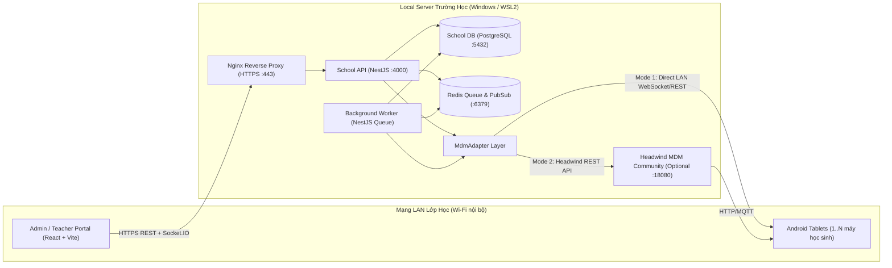

# Kiến Trúc Hệ Thống School MDM Portal

## 1. Tổng quan Kiến trúc (High-Level Architecture)

Hệ thống được thiết kế theo mô hình **Domain-Centric MDM Portal** chạy trên mạng nội bộ trường học (Local LAN Server), tách biệt hoàn toàn dữ liệu nghiệp vụ giảng dạy khỏi tầng điều khiển thiết bị vật lý.



## 2. Kiến trúc Đa Provider (`MdmAdapter`) – Tối Ưu Chi Phí 0 Đồng

Để giải quyết bài toán **không phát sinh chi phí bản quyền Enterprise** nhưng vẫn đáp ứng 100% nhu cầu điều khiển thiết bị trong tiết học, tầng `MdmAdapter` chuẩn hóa giao diện:

```typescript
export interface MdmAdapter {
  connect(): Promise<{ connected: boolean; providerVersion: string; message?: string }>;
  getDevices(query?: MdmDeviceQuery): Promise<MdmExternalDevice[]>;
  getDevice(externalDeviceId: string): Promise<MdmExternalDevice | null>;
  getApplications(): Promise<MdmExternalApplication[]>;
  getDeviceApplications(externalDeviceId: string): Promise<MdmDeviceInstalledApp[]>;
  sendCommand(command: MdmCommandEnvelope): Promise<MdmCommandDispatchResult>;
  getCommandStatus(externalCommandId: string): Promise<MdmCommandStatusResult>;
  getCapabilities(): Promise<MdmCapabilityMatrix>;
}
```

### Hai Provider chính:
1. **`HeadwindAdapter` (`HEADWIND_COMMUNITY`):**
   - Kết nối tới Headwind MDM Community qua REST API.
   - Tự động kiểm tra phiên bản và khai báo chính xác các capability được hỗ trợ (ví dụ: `deviceInventory: true`, `appCatalog: true`, nhưng `kioskMode: false` hoặc `urlFiltering: false` nếu bản Community chưa có add-on trả phí).
2. **`ClassroomDpcAdapter` (`CLASSROOM_DPC` – 0 đồng chi phí bản quyền):**
   - Sử dụng quyền `Device Owner` gốc miễn phí của hệ điều hành Android (`android.app.admin.DevicePolicyManager`).
   - Hỗ trợ đầy đủ các thao tác giảng dạy tại lớp:
     - `LOCK_DEVICE`: Khóa màn hình toàn lớp tức thì (`lockNow()`).
     - `APPLY_KIOSK_POLICY`: Khóa máy chỉ mở ứng dụng bài học (`startLockTask()`).
     - `APPLY_ALLOWLIST`: Ẩn/đóng băng ứng dụng giải trí trong giờ học (`setPackagesSuspended()`).
     - `INSTALL_APP` / `REMOVE_APP`: Cài đặt APK âm thầm từ Local Server qua mạng LAN.

## 3. Phân quyền RBAC & Phạm vi Lớp học (Class Scope)
- **`ADMIN`:** Quản trị toàn trường (năm học, lớp, người dùng, danh mục thiết bị, cấu hình MDM, chính sách, báo cáo, nhật ký audit).
- **`TEACHER`:**
  - Chỉ truy xuất được các lớp học có bản ghi phân công hiệu lực trong `teacher_classes`.
  - Chỉ xem và điều khiển được các thiết bị đang được gán (`device_assignments` active) cho lớp mình phụ trách.
  - Mọi kiểm tra được thực thi tại Guard/Service của `apps/api` và Room Guard của `Socket.IO`.
